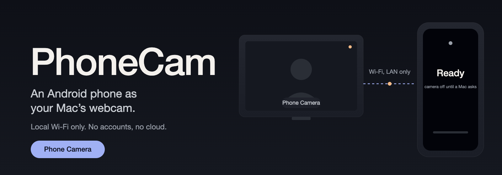
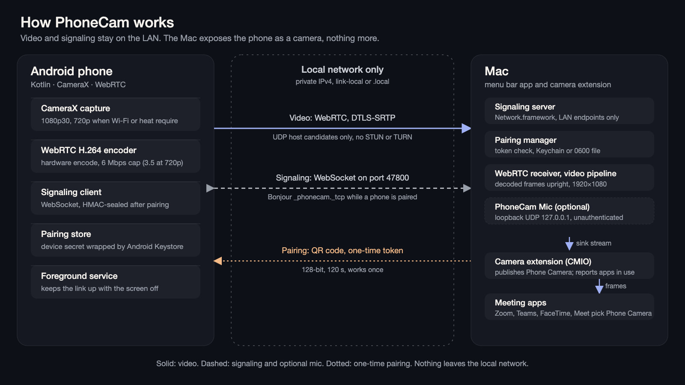

# PhoneCam

Use an Android phone as a webcam for your Mac, over your local Wi-Fi. Meeting apps see a camera called **Phone Camera**. No OBS, no accounts, no cloud.



*Illustration, not a screenshot. Source: [`docs/img/hero.svg`](docs/img/hero.svg).*

- **Direct, local video.** The phone sends H.264 over WebRTC (DTLS-SRTP) straight to the Mac on your LAN. Capture is 1080p30 with hardware encoding; the phone steps down to 720p on weak Wi-Fi or when it runs warm.
- **A camera every app can use.** A macOS camera extension publishes "Phone Camera" to any app that lists cameras. When frames stop, the extension shows a placeholder instead of a frozen image.
- **Camera on demand.** The phone stays connected with its camera off ("Ready") until an app on the Mac uses Phone Camera. It turns off 10 s after the last app stops.
- **One phone, several Macs.** A phone can be paired with any number of Macs. It streams to one at a time; a waiting Mac can take the camera over.
- **Optional phone microphone.** A per-Mac switch can send the phone's microphone through a small virtual audio driver. It is off by default; the Mac's own microphone is the normal path.

## How it works



*Diagram drawn for this README. Source: [`docs/img/architecture.svg`](docs/img/architecture.svg).*

- **Android app** (`android/`, Kotlin): CameraX capture feeds WebRTC's hardware H.264 encoder (6 Mbps cap; 3.5 Mbps at 720p). A foreground service keeps the link up with the screen locked. Pairing codes are read with ML Kit.
- **Mac menu bar app** (`mac/PhoneCam`, Swift/SwiftUI): pairs with the phone, receives the stream, composites each frame to upright 1920×1080 (`FrameCompositor`), and feeds the camera extension.
- **Camera extension** (`mac/PhoneCamExtension`, Core Media I/O system extension): publishes Phone Camera in 1080p and 720p formats. The app sends frames through the extension's sink stream; if no fresh frame arrives within 1 s, the extension shows its own placeholder. It also reports how many apps are using the camera, which drives camera on demand.
- **Shared core** (`mac/Packages/PhoneCamCore`): pairing and crypto, the signaling server, the compositor and the multi-Mac camera handover. Covered by the Swift test suite.

Design constraints: frames cross from the app to the extension only through the CMIO sink stream (no App Groups, shared memory or custom XPC); ICE uses host candidates only (no STUN or TURN); signaling is a LAN WebSocket on port 47800 (or any free port), advertised as `_phonecam._tcp`.

**Pairing.** The Mac shows a QR code with a one-time token. The phone asks you to confirm the Mac's name and address, then proves it saw the code with an HMAC over the token, the device ID and a nonce. The Mac returns a device secret sealed with AES-GCM. From then on both sides authenticate every connection, and every signaling message is HMAC-sealed. The signaling messages are HMAC-keyed from the token or the device secret, so something else on the network cannot swap the DTLS fingerprints that the SDP carries (see [`STATUS.md`](STATUS.md), Decisions).

## Security and privacy model

- **LAN only, enforced in code.**
  - A pairing code is rejected unless every host in it is a private IPv4 address (`android/.../Protocol.kt`, `ProtocolTest.kt`).
  - The Mac refuses connections from endpoints that are not LAN addresses (`SignalingServer.swift`, `LanAddress.isLAN`).
  - The Mac's listener prohibits cellular and "other" interface types (`SignalingServer.swift`, `prohibitedInterfaceTypes`).
  - Both sides drop network candidates that point off the LAN, and the Mac filters the SDP in both directions (`LanAddress.filterSDP`, `WebRTCReceiver.swift`).
  - Bonjour advertising is off until a phone is paired (`SignalingServer.swift`).
- **One-time pairing token.** 128 random bits, valid for 120 s, accepted once (`PairingManager.swift`). Wrong guesses do not burn the real token (`PairingTests.testInvalidTokensDoNotBurnTheRealOne`). The proof is bound to the device ID and nonce, so it cannot be replayed for another device (`testProofBoundToDeviceIdAndNonce`).
- **Secrets at rest.** Team-signed Mac builds keep trusted phones in the data-protection Keychain, scoped to this Mac and this app. Ad hoc builds, which cannot use that Keychain, fall back to a 0600 file. The phone wraps its device secret with an Android Keystore key (`PairingStore.kt`).
- **What never leaves your network.** Video, audio, signaling and pairing traffic run device to device on the local network. There are no accounts, no cloud relay and no STUN or TURN servers. The Gradle files contain no analytics or crash-reporting SDK. Mobile data is never used.
- **Known gaps.** The Mac's microphone path is a loopback UDP feed on 127.0.0.1 with no authentication, so another local process could feed it. The camera extension cannot verify which process feeds it; a local process with camera access could feed Phone Camera while PhoneCam is not running. Details are under Known limitations.

## Requirements

- macOS 14 or later (tested on macOS 27.0.1), Xcode 26 or later, and [XcodeGen](https://github.com/yonaskolb/XcodeGen) (`brew install xcodegen`).
- An **Apple Developer team** to sign the camera extension (see Signing). Without one, everything except the virtual camera works.
- Android 10 (API 29) or later. JDK 17 or later (Android Studio's bundled JBR works).
- Phone and Mac on the same network, with devices allowed to reach each other (not a guest network, and no "AP/client isolation").

## Quickstart

### 1. Sign and install the Mac app

macOS loads camera extensions only from apps signed by an Apple Developer team, with the System Extension capability, installed in `/Applications`. Nothing here disables SIP or uses developer mode.

1. Join the Apple Developer Program (an individual membership is enough). Add the same Apple ID in Xcode › Settings › Accounts. This was verified on 2026-10-17 with a paid Individual team; a free Personal Team is untested for the System Extension capability.
   Find your Team ID in Xcode's Accounts pane, or open `mac/PhoneCam.xcodeproj` in Xcode once and run `defaults read com.apple.dt.Xcode IDEProvisioningTeamByIdentifier` (look for `teamID`, with `isFreeProvisioningTeam = 0` for a paid team).
2. Create `mac/Local.xcconfig`:
   ```
   DEVELOPMENT_TEAM = ABCDE12345
   PHONECAM_APP_ENTITLEMENTS = PhoneCam/PhoneCam.entitlements
   PHONECAM_EXT_ENTITLEMENTS = PhoneCamExtension/PhoneCamExtension.entitlements
   PHONECAM_HARDENED_RUNTIME = YES
   CODE_SIGN_IDENTITY = Apple Development
   ```
   Replace `ABCDE12345` with your Team ID.
3. Run `mac/scripts/install.sh`. It builds, signs with automatic provisioning, registers this Mac with the team, copies the app to `/Applications` and opens it. It stops without installing if the build fails. Without `Local.xcconfig` it builds ad hoc, which runs everything except the camera extension.
4. In the PhoneCam menu, click **Install**. Then turn PhoneCam on in System Settings › General › Login Items & Extensions › Camera Extensions. Allow camera access when PhoneCam asks; macOS hides camera devices, including PhoneCam's own, from apps without it.

Gotchas seen while bringing this up:
- `validationFailed` from the extension request is not always a signing problem. `sysextd` also refuses an extension whose Info.plist lacks `CFBundleShortVersionString`. Check with `log show --predicate 'process == "sysextd"' --last 5m`.
- `spctl` reports "rejected" for Apple Development-signed builds. That is expected and does not block the extension on the Mac it was built for.
- The extension has no provisioning profile of its own; only the app needs one (for `system-extension.install`).

### 2. Build and install the Android app

```sh
cd android
JAVA_HOME="/Applications/Android Studio.app/Contents/jbr/Contents/Home" ./gradlew assembleDebug
adb install -r app/build/outputs/apk/debug/app-debug.apk
```

### 3. Pair and use

1. Open PhoneCam on the phone, allow the camera, and scan the code shown in the Mac's PhoneCam menu (the Pixel camera app can also open it). Confirm the Mac's name on the phone.
2. The phone shows **Ready**: connected, camera off. Opening the Mac menu turns the camera on so you can check framing.
3. In Zoom, Teams, FaceTime, Meet and similar apps, pick **Phone Camera**. The phone's camera starts within a couple of seconds and stops 10 s after the app lets go. Keep the Mac's microphone selected unless you turn on the phone microphone.
4. Next time, just open PhoneCam on the phone; it reconnects by itself. If an app wants Phone Camera while the phone is not connected, the Mac posts a notification.

Controls: **Stop/Start** in the Mac menu pauses the phone's camera. Switch lenses on the phone (Back 0.5× / 1× / tele / Front) or from the Mac menu, which appears whenever a phone is connected. **Forget…** (Mac) and **Forget** next to each Mac (phone) ask before revoking trust. **Open at login** is switched on after the first pairing. The menu shows the phone's battery, heat and any 720p step-down. Your self-view in meeting apps is mirrored by the app, so the placeholder's text reads backwards there; other people see it correctly.

## Tests

Neither suite needs a phone, a camera, a signed extension or any network beyond loopback.

```sh
# Mac core: 43 XCTest cases. Pairing and token crypto, signaling server over loopback WebSocket,
# compositor geometry and rotation, SDP tuning, LAN-only and tamper hardening, multi-Mac handover.
cd mac/Packages/PhoneCamCore && swift test

# Android JVM unit tests: 37 @Test cases. Protocol, pairing crypto, camera arbiter and handover,
# trusted-Mac list, quality policy.
cd android && JAVA_HOME="/Applications/Android Studio.app/Contents/jbr/Contents/Home" ./gradlew testDebugUnitTest
```

`docs/protocol-vectors.json` is read by the Android test (`ProtocolVectorsTest.kt`) for pairing URLs, sealed envelopes, auth messages and message bodies. The Swift and Kotlin crypto vectors are hard-coded: `CrossPlatformVectors` in `PairingTests.swift` and `PairingCryptoTest.kt`. Change them together. `.github/workflows/ci.yml` runs both suites plus a build; device, meeting-app and signed-extension checks are manual and tracked in [`STATUS.md`](STATUS.md). `mac/scripts/camcheck.swift` checks that the installed camera delivers live frames.

## Status and limits

Status is recorded in [`STATUS.md`](STATUS.md), with the evidence next to each claim. Only what is listed there as verified on a physical device counts as verified on hardware; emulator results are labelled as such.

**Measured on hardware** (per STATUS.md and the files cited):
- Pixel 6 Pro (Android 14) to a Mac Studio, 2026-10-27: glass-to-glass latency median 208 ms, p90 245 ms, over 20 of 20 screen flips (`mac/scripts/latency.swift`).
- Pixel 6 Pro, about 31 minutes, 2026-10-26: [`docs/soak-2026-10-26-stab-off.csv`](docs/soak-2026-10-26-stab-off.csv) samples the frame counter every 30 s and shows about 30 fps throughout. The counter restarts once at 14:53:35. STATUS.md lists caveats for this run: the phone was unplugged part of the time, and the stream was also routed to a second Mac.

**Implemented but not verified on hardware:**
- Mac sleep and wake. The listener restarts and the phone reconnects, but this has not been exercised.
- Two-Mac camera handover. Unit-tested only.
- An incoming call or another app taking the camera on the phone.
- The phone microphone in Zoom, Teams or Meet. The Mac-side audio path has been checked; the meeting-app test has not.

**Limits:**
- **Signing**: the virtual camera needs a team-signed build. Ad hoc builds stream and preview, but cannot publish Phone Camera.
- **Mac sleep**: video stops while the Mac sleeps. On wake the app restarts its listener, and the phone reconnects on its own, the same way it does after a Wi-Fi drop.
- **Phone**: streaming continues with the screen locked or the app in the background (foreground service). Android ends it if the app is force-stopped. If another app or a video call takes the camera, the stream pauses until the camera is free. Ordinary phone calls do not need the camera. The phone must be on the same network; mobile data is never used.
- **Portrait** phones are pillarboxed, not distorted. Hold the phone sideways for a full-frame 16:9 picture.
- **Audio**: the Mac's microphone is the default. A per-Mac "Phone microphone" switch sends the phone's microphone through the PhoneCam Mic driver. Enabling it installs a HAL driver with an administrator prompt. A meeting app that uses only PhoneCam Mic also turns the phone camera on.
- **One phone at a time per Mac.** A newer connection replaces the old one; the replaced phone is told so and stops retrying. A phone stays linked to every Mac it is paired with, and streams to one Mac at a time.
- **Who may feed the camera**: the extension accepts one feeder at a time, so nothing can take over a running PhoneCam's feed. It cannot verify that the feeder is PhoneCam, because macOS reports no signing ID for it and the extension's sandbox cannot read other processes' signatures. A local process with camera access could feed Phone Camera while PhoneCam is not running.
- **Extension updates**: macOS cannot start a replacement camera extension while the old one runs. The app re-activates it and restarts itself once, which takes about 20 s without Phone Camera. It does not update while an app is using the camera at launch.
- **Screen-off streaming** relies on Wi-Fi locks. The low-latency lock only applies with the screen on, so the app also holds the high-performance lock. Screen-off jitter on a real phone has not been measured.
- **Pairing data** (team-signed builds): trusted phones live in the data-protection Keychain (this Mac only, this app only). Older builds kept them in `~/Library/Application Support/PhoneCam/paired-devices.json`, which is migrated and then deleted.

## Roadmap and known issues

Drawn from [`STATUS.md`](STATUS.md). Nothing here is scheduled.

- **Physical-device checks still open:** the two-Mac handover, Mac sleep and wake, the phone's camera-recovery path (added 2026-10-26 and not yet triggered on the phone), and screen-off jitter.
- **Microphone path (known issues):** the loopback feed to PhoneCam Mic is unauthenticated, and a meeting app that uses only PhoneCam Mic still turns the phone camera on. The phone mic has not yet been tested in Zoom, Teams or Meet.
- **Lip sync:** STATUS measured video trailing the phone's audio by a median of 36 ms.
- **Documentation debt:** the header of `STATUS.md` predates its later entries. Read the dated sections rather than the header.

## Troubleshooting

| Symptom | Fix |
|---|---|
| Phone says "Can't reach <Mac>" | Same Wi-Fi? Guest or IoT networks and "client isolation" block device-to-device traffic. Phone VPNs can too. Check that the Mac firewall allows PhoneCam (System Settings › Network › Firewall › Options). |
| Menu says "This build is not signed with an Apple Developer team" | Follow Signing, then rerun `install.sh`. |
| "Move PhoneCam to the Applications folder" | Use `install.sh`, or drag the app to /Applications. |
| Extension waiting for approval | System Settings › General › Login Items & Extensions › Camera Extensions → enable PhoneCam. |
| Meeting app doesn't list Phone Camera | Quit and reopen the meeting app after the extension is first approved. |
| Meeting app shows "Open PhoneCam on your Mac" | The menu bar app isn't running, or it just restarted after an extension update. Open PhoneCam. |
| Meeting app shows "No phone" / "Stopped on phone" | Open PhoneCam on the phone (it was closed, or Stop was tapped there). |
| Phone says "<other phone> is now the camera" | Only one phone streams at a time; the newest connection wins. Tap Start to take over. |
| Phone says "Camera in use by another app" | Another app took the camera (for example, a video call on the phone). PhoneCam resumes when it is released; the Mac shows the placeholder meanwhile. |
| "This Mac no longer trusts this phone" | The phone was forgotten on the Mac. Scan a new code. |
| Code expired or already used | Codes last 2 minutes and work once. Click **New code** in the Mac menu. |

**Logs.** The Mac writes stats every 2 s to `~/Library/Logs/PhoneCam/stats.csv` (rotated at 5 MB). Columns include `consumers` (apps using Phone Camera), `pipe_drop` (frames skipped because compositing fell behind), `freezes`, `pli`, and the phone's battery and heat. `mac/scripts/soak.py 30` summarizes a 30-minute run; keep a consumer open, or run `defaults write com.zanghi.phonecam PhoneCamAlwaysOn -bool YES`. To follow the app's log: `log stream --predicate 'subsystem BEGINSWITH "com.zanghi.phonecam"'`. On the phone: `adb logcat -s PhoneCam PhoneCamSignal`.

## Project notes

- [`PLAN.md`](PLAN.md): milestones and acceptance criteria.
- [`STATUS.md`](STATUS.md): requirement tracker and dated evidence.

## License

Not yet chosen.
